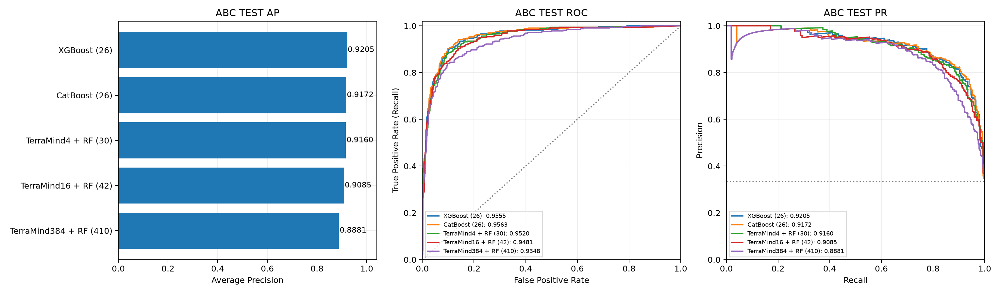

# 강우·지형 정보를 활용한 산사태 발생 기록 분석

발생 시점과 위치의 해상도가 낮은 산사태 기록을 활용하여 **강우·경사·토지피복 변수의 상대적 중요도를 분석하고, 강우 임계값 산정 시 고려할 변수와 누적 강우기간을 탐색**하는 연구다. 모델의 분류 성능과 SHAP 기여도를 함께 분석한다.

최신 학습·TEST 재현 패키지는 [experiments/model_comparison](experiments/model_comparison/)에 있다. 가공된 입력 파일을 포함하며, 원 산사태 목록·원 DEM·개인 경로·인증정보는 포함하지 않는다. 자료 구축용 실행 스크립트는 `scripts/`에 보존하며, 상세 과정은 [전처리 문서](docs/preprocessing.md)에서 확인할 수 있다.

## 프로젝트 구성

```text
scripts/                       원자료 전처리
config/                        전처리 설정
docs/                          자료 구축 방법
experiments/model_comparison/  모델 학습·TEST·SHAP와 가공 데이터
```

## 실행

Python 3.13.5 환경에서 검증했다. Jupyter를 사용하는 경우 아래 의존성을 설치한 환경을 커널로 선택한다.

```bash
python -m pip install -r experiments/model_comparison/requirements.txt
cd experiments/model_comparison
python training.py --model xgboost --case ABC
```

모델별 실행 노트북 5개는 패키지의 [notebooks/](experiments/model_comparison/notebooks/)에 있다. 모두 가공 파일에서 독립적으로 시작하여 **학습 → VALID 확인 → 고정 TEST 평가 → SHAP**를 실행한다. 실행 결과는 `output/model_comparison/`, 실행·QC·오류 로그는 대응하는 `log/`에 저장한다.

## 비교 모델과 입력

| 실행 모델 | 최종 입력 수 | 구성 |
| --- | ---: | --- |
| `xgboost` | 26 | 누적 강우·경사·토지피복 → XGBoost |
| `catboost` | 26 | 같은 기본 변수 → CatBoost |
| `terramind4_rf` | 30 | 기본26 + 학습된 DEM 압축특징4 → RF |
| `terramind16_rf` | 42 | 기본26 + 학습된 DEM 압축특징16 → RF |
| `terramind384_rf` | 410 | 기본26 + 고정 TerraMind DEM특징384 → RF |

기본26변수는 **1–15일 누적 융합강우15개, 경사4개, 토지피복 면적비율7개**다. 최대시우량은 입력에서 제외했다. 독립 MLP 분류기는 포함하지 않는다. 4·16특징은 별도 보조 신경망으로 압축하여 만든 특징이며, 최종 분류기는 RF다. 사전학습 TerraMind 본체는 고정했고 배포한 DEM384 캐시를 사용하므로 원 DEM 전체를 재추론하거나 TerraMind 가중치를 다운로드할 필요가 없다.

## A·B·C 데이터는 어떻게 만들었나

2021–2025년 산림청·한국도로공사 산사태 기록을 법정리 또는 읍·면·동에 연결하고, AWS·ASOS 강우로 나눈 대표 강우 이벤트와 연결했다. 정확한 발생 시각이 없는 기록은 기록 기간의 최대 시간융합강우 시각을 이용하여 대표 이벤트를 추정하고 불명확한 경우는 미확정으로 남겼다. 이 **표본 연결 규칙**과 최대시우량을 **모델 변수**로 사용하는 것은 구분한다.

| 유형 | 표본 구축 | 학습 라벨 |
| --- | --- | ---: |
| A: 발생 기록 | 산사태 발생 기록이 연결된 행정구역·대표 강우 이벤트. 같은 구역·이벤트의 원 기록은 묶음 | 1 |
| B: 시간 대조 | A와 같은 구역에서 선택한 다른 강우 이벤트. 알려진 발생 기간·관련 이벤트와 겹치는 후보 제외 | 0 |
| C: 공간 대조 | A의 이벤트 시간대를 유지하고 다른 구역 선택. 알려진 발생 기록·관련 이벤트 및 공간자료 QC 확인 | 0 |

A 한 개와 B·C 각 한 개를 `TRIPLET_ID`로 연결했다. **B·C의 0은 발생 기록 미포착을 뜻하며 실제 미발생이 확정된 표본은 아니다.** 최종 1,612묶음·4,836행이다. 상세 이벤트 구분, 대표 이벤트 선택, 대조군 제외 기준은 [연구 방법](experiments/model_comparison/README.md)과 [데이터 설명](experiments/model_comparison/DATA.md)을 따른다.

## 데이터와 평가 기준

가공 입력은 [samples.xlsx](experiments/model_comparison/data/processed/samples.xlsx)와 [DEM 특징 Parquet](experiments/model_comparison/data/processed/dem_embeddings.parquet)으로 제공한다. 엑셀 `Samples` 시트에 표본키·라벨·원 분할·기본26변수·QC, `Dictionary` 시트에 열 설명과 단위를 담았다. 파일 SHA-256은 [manifest.json](experiments/model_comparison/data/processed/manifest.json)에 기록했다.

- TRAIN 966묶음·2,898행, VALID 322묶음·966행, 원 TEST 322묶음·966행, HOLD 2묶음·6행.
- 같은 A·B·C 묶음과 같은 구역의 중첩 강우 창을 같은 분할에 배정했다. 다른 구역의 같은 강우사건은 분할 사이에 남을 수 있다.
- TEST 비교는 DEM 미확보 부귀리 1묶음을 공통 제외한 **321묶음·963행**이다. `COMMON_TEST_INCLUDED`에 표시하고 원 분할·제외 사유를 보존했다.
- 전처리·가중치는 TRAIN에서 학습한다. 압축기만 VALID BCE로 epoch를 선택한다. 판정 기준은 0.5를 유지하며 TEST에서 조정하지 않는다.
- [성능표](experiments/model_comparison/reports/metrics.csv)는 AP·ROC-AUC·Accuracy·Precision·Recall·F1과 혼동행렬을 VALID·TEST로 구분한다.

## 결과

실행 결과와 변수별 중요도는 [실험 패키지의 reports/](experiments/model_comparison/reports/)에 저장한다. 최신 수치는 아래 재현 평가 표와 `reports/metrics.csv`를 따른다.

| 모델 | TEST AP | TEST ROC-AUC | TEST Accuracy |
| --- | ---: | ---: | ---: |
| XGBoost (26) | 0.9205 | 0.9555 | 89.72% |
| CatBoost (26) | 0.9172 | 0.9563 | 89.51% |
| TerraMind4 + RF (30) | 0.9160 | 0.9520 | 88.58% |
| TerraMind16 + RF (42) | 0.9085 | 0.9481 | 89.30% |
| TerraMind384 + RF (410) | 0.8881 | 0.9348 | 88.16% |



위 표는 제공 데이터에서 재학습·평가한 고정 설정의 ABC 결과다. 기본 XGBoost의 AP가 가장 높았고, 384개 DEM 특징을 그대로 연결한 RF보다 4·16차원 압축형 RF의 TEST AP가 높았다. 이 차이의 유의성이나 외부 일반화는 별도 검증하지 않았다.

다섯 모델 모두 TEST SHAP에서 **이벤트 종료일을 포함한 2일 누적강우량(`FUSION_02D_MM`)**의 평균 절대 기여도가 가장 높았다. 이는 발생 시각 직전의 정확한48시간 강우나 인과효과를 뜻하지 않는다. [변수별 중요도](experiments/model_comparison/reports/feature_importance.csv)와 [상위10개 비교 그림](experiments/model_comparison/reports/shap_top10.png)을 함께 확인한다.

## 해석 범위

발생 위치와 시점의 해상도가 낮아 사건 단위의 **발생 기록 분류 및 변수 중요도 탐색**을 수행했다. 강우 입력에는 이벤트 종료일 전체가 포함되어 실제 발생 후 강우가 들어갈 수 있으므로 실시간 사전 예측 성능으로 해석하지 않는다. 표본의 양성 비율1/3은 실제 전체 지역의 발생률이 아니다.

SHAP는 예측 점수에 대한 기여도이며 원인의 인과효과나 강우 임계값 자체가 아니다. 누적 강우 변수 사이의 상관성과 토지피복·경계 시점의 불확실성을 함께 고려한다. 이미 여러 차례 확인한 TEST를 재사용한 탐색 비교이며, 새로운 연도·지역 일반화와 작은 성능 차이의 유의성은 추가 검증이 필요하다.

## 자료 출처와 프로젝트 구성

자료 제공기관과 이용 조건은 [DATA.md](experiments/model_comparison/DATA.md#원자료-출처와-권리), 업로드 범위는 [SECURITY.md](SECURITY.md)를 따른다. 코드와 데이터·모델의 권리를 구분하며 원자료의 재배포 권한이나 새로운 라이선스를 임의로 부여하지 않는다.

공유 구조는 [Cookiecutter Data Science](https://cookiecutter-data-science.drivendata.org/)의 데이터·노트북·코드·보고서 분리 방식을 참고했다. 기존 전처리 코드의 일반 경로 `/data/project`, `/data/RAIN_DATAS`, `/data/DEM_5m`은 로컬 환경에 맞춰 준비해야 한다. **최신 실험 패키지의 모델 재현은 제공한 가공 파일만으로 실행**하며 앞선 전체 원자료 파이프라인의 재실행은 필요하지 않다.
